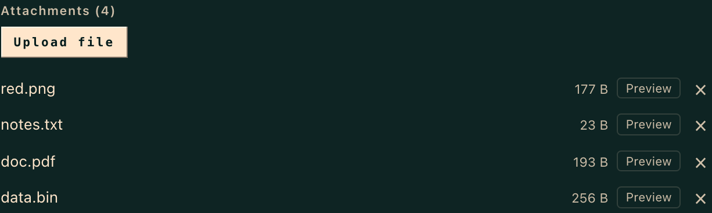
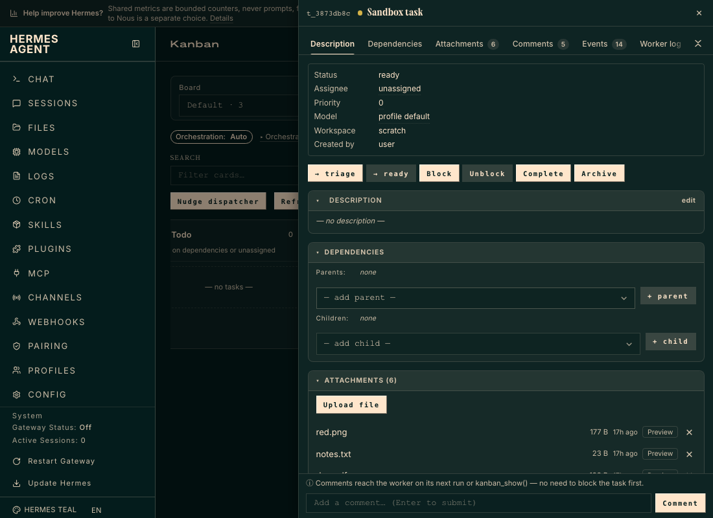
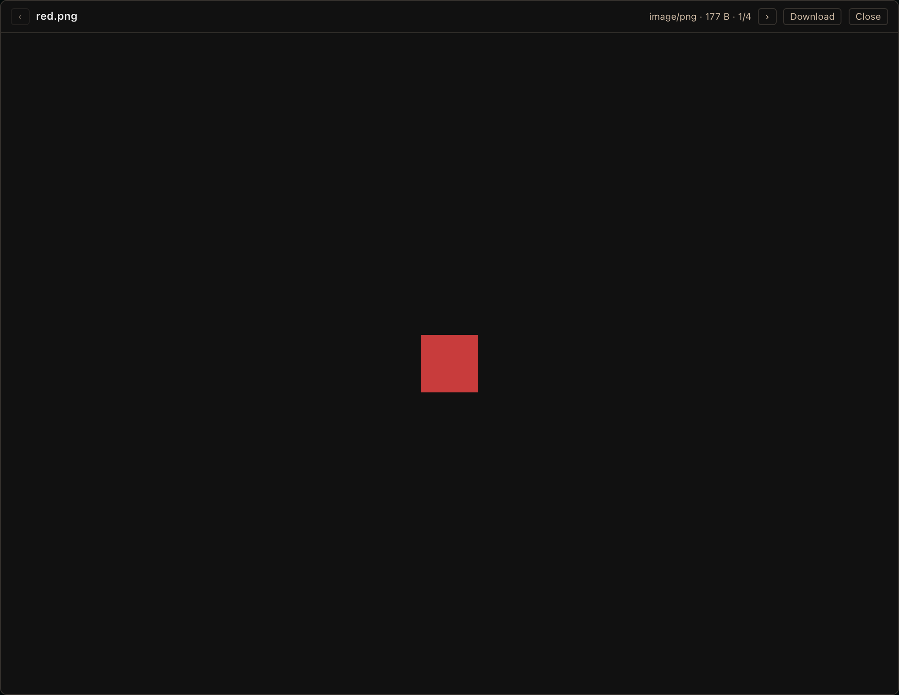
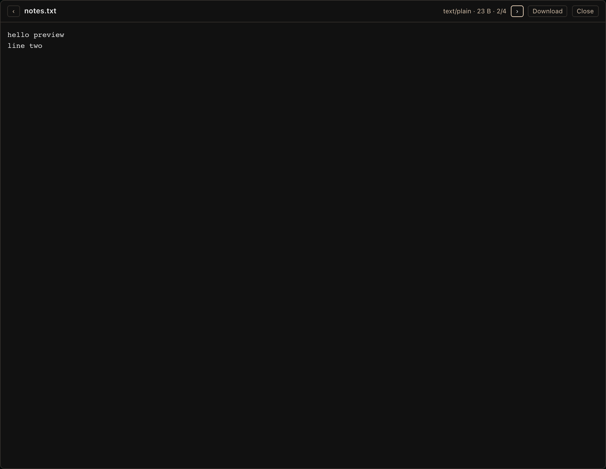
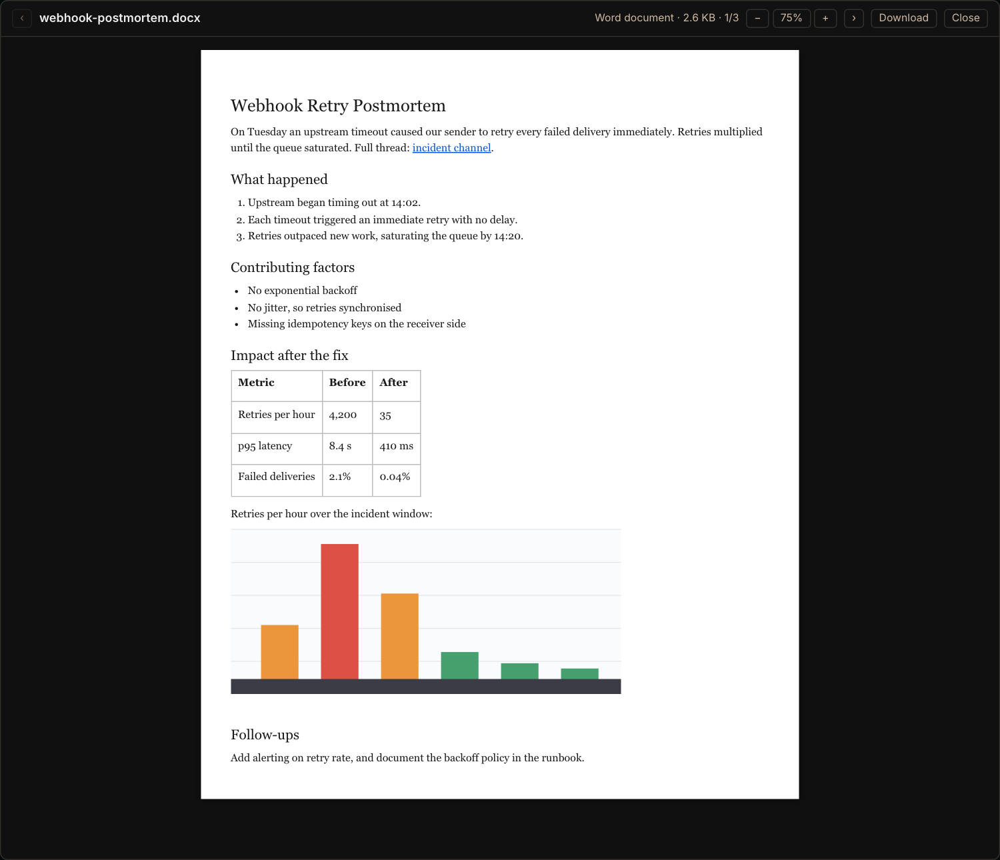

# hermes-kanban-attachment-preview

[](LICENSE)

Preview attachments on the [Hermes Agent](https://github.com/NousResearch/hermes-agent) kanban board without downloading them.

The built-in task drawer lists attachments as download links. This plugin adds a **Preview** button to each row that opens the file in a modal, so you can check a screenshot, log or PDF a worker produced without leaving the board.









Word documents render as a readable page, including headings, lists, tables, links and embedded images:



## Features

- **Images** (PNG, JPEG, GIF, WebP, AVIF, BMP, SVG), **PDF**, **audio**, **video**, **text** (logs, JSON, YAML, CSV, Markdown, source code and more), and **Word (.docx)** documents.
- **Upload time** on every attachment row ("17h ago", or the date once older than a week), with the full date and uploader in the tooltip, plus a "newest" marker on the most recent upload. The preview header also shows the full upload date.
- **Prev / next** across all of a task's attachments, with ← / → keys.
- **Download** button in the modal.
- **Esc closes the preview only**, not the drawer behind it.
- Unknown file types show a clear "no preview" note with Download as the fallback.
- Word documents render as a readable page that fits the window at a compact default zoom (75%), with **− / +** buttons (or the `-`, `+` and `0` keys) to zoom from 50% to 175%; the zoom is remembered per browser. They show: headings, bold/italic/underline, links, bulleted and numbered lists, tables. Embedded PNG/JPEG/GIF/WebP/BMP images are shown inline. SVG/EMF/WMF images, headers/footers, footnotes and tracked deletions are not (the modal says how many images were skipped). It is a preview, not a layout engine; Download for the real thing. Legacy `.doc`, `.xlsx` and `.pptx` get the "no preview" note.
- Text previews are capped at 512 KB; the modal says so when a file is truncated.

## Install

User dashboard plugins must be present in `~/.hermes/plugins/` **and** listed in `plugins.enabled`.

```bash
git clone https://github.com/zachristmas/hermes-kanban-attachment-preview.git ~/.hermes/plugins/kanban-attachment-preview
hermes plugins enable kanban-attachment-preview
curl http://127.0.0.1:9119/api/dashboard/plugins/rescan   # or restart `hermes dashboard`
```

Then hard-refresh the dashboard. (`hermes plugins enable` prints a "restart the gateway" notice. That applies to the agent side only; this plugin has none.)

Uninstall with `hermes plugins disable kanban-attachment-preview` and delete the directory.

## How it works

The kanban drawer exposes no plugin slots and its attachment rows carry no id, so the plugin watches the page with a `MutationObserver`, adds a button to each row, and on click fetches the task's attachment list from the board's own API (`/api/plugins/kanban/tasks/<id>/attachments`), matching the row by filename and size. Files are fetched with the dashboard's authenticated fetch and shown from blob URLs. It adds no backend routes and sends nothing anywhere new.

### Safety

Attachments are untrusted content, so nothing is ever rendered as HTML:

- Text goes into the page via `textContent`, including `.html` files.
- SVG is shown through an `` tag, so embedded scripts do not run.
- Blob types come from a fixed allow-list (PDFs are forced to `application/pdf`), never from the stored type alone.

## Compatibility and limitations

- Tested against Hermes `v0.21.7` (canary build). It depends on the board's `.hermes-kanban-*` class names, which are not a public API: **a Hermes update that renames them will break the plugin silently.** Rerun the tests after upgrading.
- PDF display relies on the browser's built-in PDF viewer. Headless and some mobile browsers show a blank frame; use Download there.
- Whole files are fetched before display, so very large media (the board caps attachments at 25 MB) loads before it plays.
- The .docx renderer is a small purpose-built parser (unzip via [fflate](https://github.com/101arrowz/fflate), MIT) that builds DOM nodes with `textContent` only, so document text never becomes markup. Complex layouts will look simpler than in Word.
- No inline thumbnails yet; preview is on demand.

## Development

The E2E test runs against a **sandbox** dashboard (a throwaway `HERMES_HOME` with this plugin enabled), never a live board.

1. Create a sandbox home, symlink this repo into `$HERMES_HOME/plugins/kanban-attachment-preview`, run `hermes plugins enable kanban-attachment-preview`, and start `hermes dashboard --port 9229`.
2. Seed one task with attachments, in this order, via `hermes kanban attach`: `red.png` (a 64×64 PNG), `notes.txt` (containing "hello preview"), `doc.pdf`, `data.bin`, then `report.docx` (real Word markup: Heading1/Heading2 styles, a bold run, an external hyperlink to https://example.com/x, a numbered list with a nested bullet, a table whose first cell spans 2 columns, a tracked delete + insert, one 64×64 PNG (alt text "red square") and one `.emf` image, and the literal text `<script>alert(1)</script>`) and `plan.docx` (any .docx whose text contains "Quarterly Plan" and "Owner").
3. Run:

```bash
cd e2e && npm install
KANBAN_E2E_URL=http://127.0.0.1:9229 KANBAN_E2E_TASK=<seeded task id> npx playwright test
# optional: CHROMIUM_PATH=<existing chrome-headless-shell> to skip the browser download
```

`dashboard/dist/index.js` is built from `src/` with `npm install && npm run build` and is committed, so installing needs no build.

## License

[MIT](LICENSE) © 2026 Zach Christmas

The built bundle includes [fflate](https://github.com/101arrowz/fflate) 0.8.3 (MIT, © Arjun Barrett) for unzipping .docx files.
